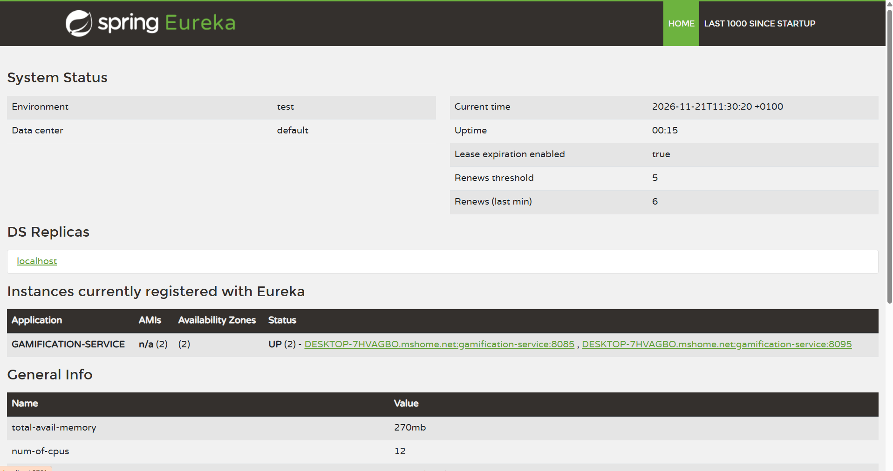

# Gamification Service (MS5)

Points, niveaux, badges et avatars des etudiants. Route Gateway : `/api/gamification/**` — port `8085`.

Ce service est un **client Eureka** : il s'enregistre au demarrage dans le serveur de decouverte
(voir le dossier `backend/0-Eureka-Server`) sous le nom `GAMIFICATION-SERVICE`, et expose sa sante via **Spring Boot Actuator**.

## Liens utiles (service lance en local)

| Quoi | Lien |
|------|------|
| Swagger (documentation de l'API) | http://localhost:8085/swagger-ui/index.html |
| **Dashboard Eureka** (le service doit apparaitre `UP`) | http://localhost:8761 |
| **Sante du service** (Actuator) | http://localhost:8085/actuator/health |
| Informations du service (Actuator) | http://localhost:8085/actuator/info |
| Metriques (Actuator) | http://localhost:8085/actuator/metrics |
| 2e instance (port 8095) : sante | http://localhost:8095/actuator/health |

## Lancer en local

Ordre important : **1) le serveur Eureka, 2) le service**.

1. Lancer le serveur Eureka (voir `backend/0-Eureka-Server/README.md`), disponible sur http://localhost:8761.
2. Lancer le service :

```bash
./mvnw spring-boot:run        # Linux / Mac
mvnw.cmd spring-boot:run      # Windows
```

Le service demarre sur http://localhost:8085 avec une base **H2 en memoire** (rien a installer).
Les donnees disparaissent a l'arret ; les niveaux, badges et avatars par defaut sont recrees a chaque demarrage.

> Si Eureka n'est pas lance, le service demarre quand meme mais affiche des erreurs de connexion
> a `localhost:8761` dans la console, et n'apparait pas dans le dashboard.

## Endpoints

| Methode | URL | Description |
|---------|-----|-------------|
| GET | `/api/gamification/hello` | Test : renvoie "Hello gamification service" |
| POST | `/api/gamification/points` | Ajouter des points `{studentId, points, reason, eventId}` |
| GET | `/api/gamification/students/{studentId}` | Points, niveau, badges, avatar |
| GET | `/api/gamification/students/{studentId}/transactions` | Historique des points |
| PUT | `/api/gamification/students/{studentId}/avatar/{avatarId}` | Choisir un avatar (si assez de points) |
| GET | `/api/gamification/leaderboard` | Top 10 |
| GET | `/api/gamification/levels` · `/badges` · `/avatars` | Donnees de reference |

```bash
curl -X POST http://localhost:8085/api/gamification/points \
  -H "Content-Type: application/json" \
  -d '{"studentId": 1, "points": 120, "reason": "COURSE_COMPLETED", "eventId": "evt-1"}'

curl http://localhost:8085/api/gamification/students/1
```

## Regles

- Niveau = le plus haut `Level` dont `requiredPoints` <= total de points.
- Badge : condition au format `POINTS>=N`, attribue automatiquement.
- `eventId` : un meme evenement n'est applique qu'une seule fois (utile pour RabbitMQ).

## Enregistrement dans Eureka (ce qui a ete fait)

Le service est devenu un **client Eureka** : il s'enregistre sous son nom logique
(`spring.application.name=gamification-service`, affiche `GAMIFICATION-SERVICE` dans Eureka),
envoie un heartbeat toutes les 30 secondes, et les autres services peuvent le retrouver par ce nom,
sans adresse IP ecrite en dur.

### 1. `pom.xml`

- Propriete `spring-cloud.version` = `2025.1.3` (version de Spring Cloud compatible avec Spring Boot 4.0.x / 4.1.x ;
  l'atelier cite `2025.0.0`, qui est pour Spring Boot 3.5).
- Dependances ajoutees : `spring-cloud-starter-netflix-eureka-client` et `spring-boot-starter-actuator`.
- Bloc `dependencyManagement` important le BOM `spring-cloud-dependencies`.

### 2. `application.properties`

```properties
# Eureka
eureka.client.service-url.defaultZone=http://localhost:8761/eureka
eureka.client.register-with-eureka=true
eureka.client.fetch-registry=true
eureka.instance.prefer-ip-address=true
eureka.client.healthcheck.enabled=true

# Actuator
management.endpoints.web.exposure.include=health,info,metrics
management.endpoint.health.show-details=always
management.info.env.enabled=true
info.app.name=Gamification
info.app.version=1.0.0
```

- `eureka.client.healthcheck.enabled=true` : Eureka recoit le statut reel calcule par `/actuator/health`
  (si un composant tombe, le service passe `DOWN` dans Eureka et n'est plus propose aux autres services).
- `management.endpoint.health.show-details=always` : `/actuator/health` affiche le detail des composants.

### 3. Verification

1. Lancer Eureka puis le service, attendre environ 30 secondes, **recharger** http://localhost:8761
   (la page ne se rafraichit pas toute seule) : `GAMIFICATION-SERVICE` apparait avec le statut **UP**.
2. Ouvrir http://localhost:8085/actuator/health : `"status":"UP"` avec les composants
   `db` (H2), `diskSpace`, `discoveryComposite` (dont `eureka`), `livenessState`, `readinessState`, `ping`...
3. Le composant `discoveryComposite` > `eureka` indique `"GAMIFICATION-SERVICE": 2` quand deux instances tournent.

### 4. Lancer une 2e instance (montee en charge)

- **IntelliJ** : Run > Edit Configurations, dupliquer la configuration de `GamificationServiceApplication`
  (Copy Configuration), puis Modify options > Add VM options et saisir `-Dserver.port=8095`.
- **Ligne de commande** : `mvn spring-boot:run -Dspring-boot.run.arguments=--server.port=8095`

Resultat attendu dans le dashboard : `GAMIFICATION-SERVICE` avec **2 instances** (ports 8085 et 8095), toutes deux `UP`.
Chaque instance a sa propre base H2 en memoire, donc ses propres donnees.



## Reste a faire

- Listener RabbitMQ pour l'evenement `CourseCompleted` (queue `gamification.queue`, cle `course.completed`) :
  il devra appeler `GamificationService.addPoints(...)` avec l'`eventId` de l'evenement.
