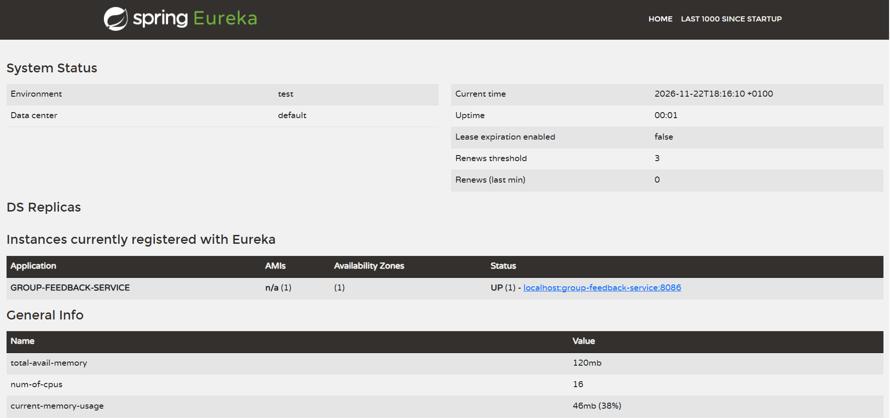

# Group Feedback Service (MS6)

Sondages anonymes sur le fonctionnement des groupes pendant le projet, etat de sante de chaque groupe
(sain, a surveiller, en difficulte) et suivi des groupes en difficulte par l'enseignant.
Route Gateway : `/api/feedback/**` — port `8086`.

Responsable : Sarra Souidi

Ce service est un **client Eureka** : il s'enregistre au demarrage dans le serveur de decouverte
(voir le dossier `backend/0-Eureka-Server`) sous le nom `GROUP-FEEDBACK-SERVICE`, et expose sa sante via **Spring Boot Actuator**.

## Liens utiles (service lance en local)

| Quoi | Lien |
|------|------|
| Test du service | http://localhost:8086/hello |
| Page d'accueil | http://localhost:8086 |
| **Dashboard Eureka** (le service doit apparaitre `UP`) | http://localhost:8761 |
| **Sante du service** (Actuator) | http://localhost:8086/actuator/health |
| Informations du service (Actuator) | http://localhost:8086/actuator/info |
| Metriques (Actuator) | http://localhost:8086/actuator/metrics |

## Lancer en local

Ordre important : **1) le serveur Eureka, 2) le service**.

1. Lancer le serveur Eureka (voir `backend/0-Eureka-Server/README.md`), disponible sur http://localhost:8761.
2. Lancer `GroupFeedbackServiceApplication` depuis IntelliJ.

> Si Eureka n'est pas lance, le service demarre quand meme mais affiche des erreurs de connexion
> a `localhost:8761` dans la console, et n'apparait pas dans le dashboard.

## Endpoints

| Methode | URL | Description |
|---------|-----|-------------|
| GET | `/hello` | Test : renvoie "Hello, je suis le microservice 6 : Group Feedback" |

## Enregistrement dans Eureka (ce qui a ete fait)

Le service est un **client Eureka** : il s'enregistre sous son nom logique
(`spring.application.name=group-feedback-service`, affiche `GROUP-FEEDBACK-SERVICE` dans Eureka),
envoie un heartbeat toutes les 30 secondes, et les autres services peuvent le retrouver par ce nom,
sans adresse IP ecrite en dur.

### 1. `pom.xml`

- Propriete `spring-cloud.version` = `2023.0.3` (version de Spring Cloud compatible avec Spring Boot 3.3.x).
- Dependances : `spring-cloud-starter-netflix-eureka-client` et `spring-boot-starter-actuator`.
- Bloc `dependencyManagement` important le BOM `spring-cloud-dependencies`.

### 2. `application.properties`

```properties
# Eureka
eureka.client.service-url.defaultZone=http://localhost:8761/eureka
eureka.client.register-with-eureka=true
eureka.client.fetch-registry=true
eureka.instance.prefer-ip-address=true
eureka.client.healthcheck.enabled=true

# Actuator
management.endpoints.web.exposure.include=health,info,metrics
management.endpoint.health.show-details=always
management.info.env.enabled=true
info.app.name=Group Feedback
info.app.version=1.0.0
```

- `eureka.client.healthcheck.enabled=true` : Eureka recoit le statut reel calcule par `/actuator/health`.
- `management.endpoint.health.show-details=always` : `/actuator/health` affiche le detail des composants.

### 3. Verification

1. Lancer Eureka puis le service, attendre environ 30 secondes, **recharger** http://localhost:8761
   (la page ne se rafraichit pas toute seule) : `GROUP-FEEDBACK-SERVICE` apparait avec le statut **UP**.
2. Ouvrir http://localhost:8086/actuator/health : `"status":"UP"`.



## Reste a faire

- Sondages, reponses anonymes, etat de sante des groupes et suivis (base MySQL `feedback_db`).
- Appels REST vers MS3 Course/Group et MS2 Profiling (OpenFeign).
- RabbitMQ : consommer `session.scheduled` (MS7) et `account.deleted` (MS1),
  publier `feedback.survey.completed` (MS5) et `feedback.group.health` (MS4).